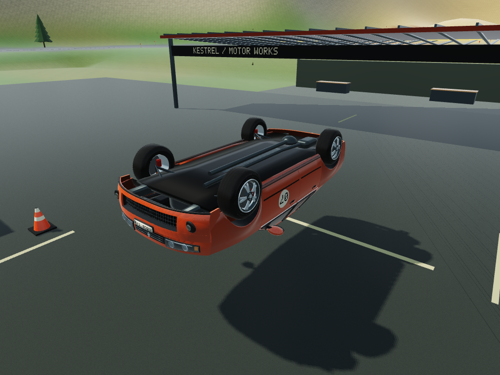

# CrumpleCar suspension rendering regression

The fixed visual control arms, spring/damper and axle links now follow the
interpolated chassis mounts and non-spinning wheel hubs. A stationary spindle
bridges each inboard joint through the brake disc to the solid hub. Detached
wheels leave no stretched links. Exploded assembly views keep chassis-side
hardware bounded. Spring frames follow the chassis continuously through travel
and rollover. These are render attachments, not new physical constraints.

## Axle-only validation (historical)

Baseline: `d4274e01ffb6847dfc0abba544ec5a4b1acd202a`.
Candidate HTML SHA-256:
`f9c7775d7ae2b60a3626a9eea63680f03e214983b16186409f5785b63fbae08b`.

- 50 focused Node tests pass with the exact baseline supplied. Tests cover all
  four cars, compressed/rest/drooped suspension, steering, wheel spin, synthetic
  damage, upside-down orientation, detached/exploded states and radial continuity.
- Original part transforms and simulation output arrays remain identical across
  matched fixtures. Embedded WASM bytes are unchanged (SHA-256
  `ae0bbd36b54465b4cfd3b854232e9f5363b635b7d6b164047ce5bfb0a0baf5e7`).
- Original V06.2 identical-WASM driving suite: 30 passed, 0 failed. Original
  physics suite: 27 passed, 0 failed. These are CPU/WASM tests, not browser FPS.
- Existing repository SEO tests: 27 passed; metadata smoke check passed.
- Full game rendered in local WebKit/WebGL2 with unchanged shipped quality.
  Twelve deliberately injected presentation fixtures verify 768 linkage
  endpoint transforms. A 360-degree roll sweep checks 92,160 radial-axis pairs;
  maximum adjacent change is 0.500012 degrees for half-degree input steps.
- No WebGL errors, page errors or renderer errors. Separately stepped shipped
  WASM settle, drive-left, drive-right and drop-test results match the baseline.

The screenshots below are actual browser renders of the same controlled
upside-down presentation fixture. They do not claim a naturally occurring
rollover or a hardware performance benchmark. Chromium could not launch in the
restricted test environment; WebGPU and the user's physical device were not
validated. WebKit used temporary writable cache/config/runtime directories.

### Before


### After


## Reproduce

```sh
git show d4274e01ffb6847dfc0abba544ec5a4b1acd202a:crumplecar/index.html > /tmp/crumplecar-before.html
CRUMPLECAR_BASELINE=/tmp/crumplecar-before.html node --test tools/crumplecar/suspension.test.cjs
python tools/crumplecar/browser-check.py --baseline /tmp/crumplecar-before.html --candidate crumplecar/index.html --output /tmp/crumplecar-browser
```

Browser reproduction requires Python Playwright and its WebKit browser. It
opens the two supplied local HTML files with network requests blocked; it does not publish
or edit either input. Keep browser-native sandbox/security settings enabled.

## Faster driving and stronger crumpling

A subsequent, separately built physics release adds 18% straight-line engine
power, tapering the extra power away at full steering to retain full-lock ridge
stability. Deformation starts at 2.5 rather than 3.1 m/s and its strength rises
30%. Attachment damage curves are unchanged. The verified binary hashes and
source revision are pinned in `physics-release.json`; source stays in its
existing private repository.

CPU/WASM comparisons: after six seconds, normal speed increases from 126.44 to
137.82 km/h (+9.0%) and boost from 151.93 to 160.03 km/h (+5.3%). At a matched
12 m/s barrier impact, crush increases from 0.305 to 0.396 m (+29.7%); attachment
health is unchanged. Tested 6/12/24 m/s crashes stay finite with no wheel loss.
The full-lock ridge check has minimum upright alignment 0.9654 and no inversion.
These are scripted simulation measurements, not a browser FPS benchmark.

The earlier browser command compares live physics equality and is appropriate
only for the axle-only revision. For the tuned version, use the candidate HTML
as both browser inputs to smoke-test rendering; the independent physics
comparison above establishes the intended driving differences.
